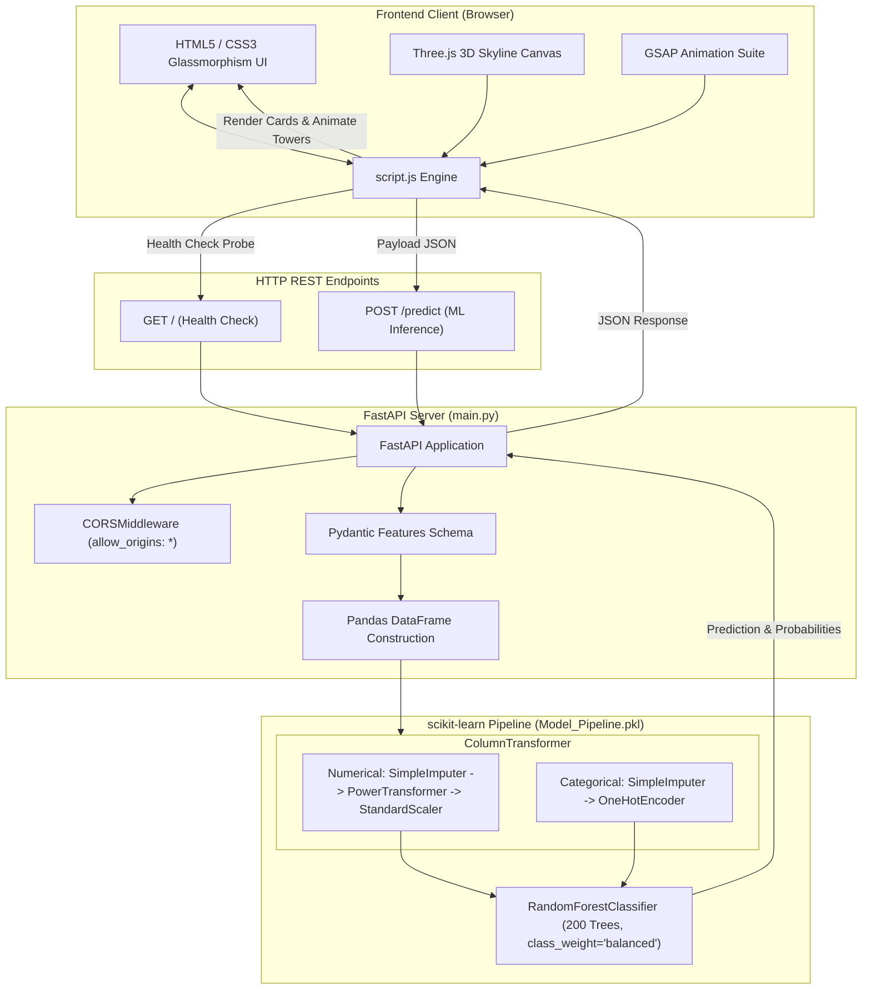

# Airbnb Intelligence · NYC Room Type Predictor

[](https://www.python.org/)
[](https://fastapi.tiangolo.com/)
[](https://scikit-learn.org/)
[](https://threejs.org/)
[](https://gsap.com/)
[](https://opensource.org/licenses/MIT)

---
[![License: MIT]](https://nyc-room-type-predictor-5.onrender.com)

---

## 2. Project Description

**Airbnb Intelligence · NYC Room Type Predictor** is a premium, futuristic full-stack artificial intelligence application that classifies New York City Airbnb listings into distinct accommodation categories (`Entire home/apt`, `Private room`, and `Shared room`).

Trained on over 48,800 real-world NYC Airbnb listings, the platform extracts spatial coordinates, pricing bounds, booking minimums, annual availability, and host reputation metrics to perform calibrated probabilistic inference. The system couples an asynchronous **FastAPI** Python backend with a cybernetic **Three.js** 3D procedural skyline and **GSAP** animation suite.

---

## Table of Contents

- [1. Project Title](#airbnb-intelligence--nyc-room-type-predictor)
- [2. Project Description](#2-project-description)
- [3. Project Overview](#3-project-overview)
- [4. Key Features](#4-key-features)
- [5. User Interface \& Screenshots](#5-user-interface--screenshots)
- [6. Technology Stack](#6-technology-stack)
- [7. Project Architecture](#7-project-architecture)
- [8. Folder Structure](#8-folder-structure)
- [9. Installation and Setup](#9-installation-and-setup)
- [10. Environment Variables Configuration](#10-environment-variables-configuration)
- [11. Database Setup](#11-database-setup)
- [12. How to Run the Project](#12-how-to-run-the-project)
- [13. How to Use the Project](#13-how-to-use-the-project)
- [14. API Documentation](#14-api-documentation)
- [15. Important Dependencies](#15-important-dependencies)
- [16. Future Improvements](#16-future-improvements)
- [17. Contributing Guidelines](#17-contributing-guidelines)
---

## 3. Project Overview

In urban short-term rental markets like New York City, listings frequently encounter miscategorization, non-standard unit types, and booking discrepancies. This application addresses that challenge through machine learning:

1. **Classification Goal**: Accurately predict whether a listing is an **Entire home/apt**, **Private room**, or **Shared room**.
2. **Machine Learning Foundation**: Leverages a robust Scikit-learn Pipeline trained on the landmark New York City Airbnb Open Data (2019). The pipeline features Yeo-Johnson power transformation to normalize skewed economic metrics, median/mode imputation, and a class-balanced **Random Forest Classifier (200 trees)** achieving **~85.6% accuracy** and **0.742 macro-F1 score**.
3. **User Experience**: Built with a dark cyberpunk visual identity featuring glassmorphic panels, two-way linked borough and neighbourhood dropdowns (covering all 217 NYC districts), and interactive architectural towers with illuminated windows that visually reflect classification confidence.

---

## 4. Key Features

- **Machine Learning Inference Engine**: Real-time classification powered by a pre-trained scikit-learn Pipeline (`Model_Pipeline.pkl`) with balanced class weights to handle minority categories like Shared Rooms.
- **FastAPI Asynchronous Backend**: RESTful endpoints (`/` health check and `/predict` inference) with Pydantic request validation and full CORS enablement.
- **Interactive Three.js 3D Skyline**: Procedural 3D Manhattan-inspired cityscape featuring dark reflective buildings, neon edge lines, rooftop spires with beacon lights, an infinite ground grid, floating data nodes, and smooth mouse-follow parallax.
- **Two-Way Linked Dynamic Dropdowns**: Comprehensive coverage of all **217 official NYC neighbourhoods** across all 5 boroughs. Selecting a borough filters its neighbourhoods; selecting a neighbourhood auto-syncs the corresponding borough.
- **Visual Building Illuminations**: Three visual room cards with architectural towers that dynamically light up window grids in real time according to class probabilities.
- **Curated One-Click Presets**: Fast scenario testing via instant presets (*Manhattan Penthouse*, *Brooklyn Bed-Stuy Suite*, *Flushing Queens Studio*, *Bushwick Co-Living Bunk*).
- **Custom Availability Range Slider**: Custom glowing gradient track with live numerical readout, annual percentage indicators, and milestone ticks.
- **Accessibility & Motion Compliance**: Honors `prefers-reduced-motion` settings and provides automatic WebGL fallbacks for non-accelerated displays.
- **Stateless Architecture**: Zero database maintenance required; executes all predictions directly in memory.

---

## 5. User Interface & Screenshots

The user interface follows a modern glassmorphism aesthetic inspired by premium AI SaaS products:

### Visual Layout Breakdown

```
+-----------------------------------------------------------------------------------+
|  [Logo] AIRBNB INTELLIGENCE                  [API Status: Online] [Predict Engine]|
+-----------------------------------------------------------------------------------+
|                                                                                   |
|  [✦ MACHINE LEARNING ENGINE]                                                      |
|  Predict Your Perfect NYC Stay.                                                   |
|  Discover the most likely Airbnb room category using machine learning...          |
|                                                                                   |
|  [📍 40.7128° N, 74.0060° W]   [⚡ Random Forest · 200 Trees]   [🏢 3 Classes]     |
|  [ Launch Prediction Studio ]  [ Load NYC Sample Preset ]                         |
|                                                                                   |
+-----------------------------------------+-----------------------------------------+
| 01 LISTING DETAILS                      | 02 PREDICTION INTELLIGENCE              |
|                                         |                                         |
| [Quick Presets: Penthouse | Loft | ...] | [AI DECISION: Entire home/apt (66.7%)]  |
|                                         |                                         |
| A. Location Intelligence                | +-------------------------------------+ |
| - Latitude / Longitude                  | | [Entire Home] [Private]  [Shared]   | |
| - Borough / Neighbourhood (217 NYC Dists| | 66.7% Match   32.5%      0.8%       | |
|                                         | | [==TOWER==]   [=TOWER=]  [-TOWER-]  | |
| B. Pricing & Stay Dynamics              | +-------------------------------------+ |
| - Price per night ($) / Min nights      |                                         |
| - Annual Availability Slider (0-365d)   | PROBABILITY DISTRIBUTION BREAKDOWN      |
|                                         | Entire home/apt [===============>] 67%  |
| C. Reviews & Host Reputation            | Private room    [========>       ] 32%  |
| - Total reviews / Reviews per month     | Shared room     [>               ]  1%  |
| - Active host listings count            |                                         |
|                                         | DIAGNOSTIC METRICS                      |
| [ PREDICT ROOM TYPE ]                   | Winner: Entire Home | Area: Midtown     |
+-----------------------------------------+-----------------------------------------+
```

*(Place screenshots of your running application in `docs/screenshots/` and reference them here)*

---

## 6. Technology Stack

### Backend & Machine Learning
| Component | Technology | Version | Purpose |
| :--- | :--- | :--- | :--- |
| **Language** | Python | `3.10` - `3.13` | Core execution environment |
| **Framework** | FastAPI | `0.115.6` | Asynchronous REST API routing |
| **ASGI Server** | Uvicorn | `0.34.0` | Production ASGI web server |
| **Validation** | Pydantic | `2.10.4` | Request payload schema validation |
| **Data Engine** | Pandas | `2.2.3` | Input data transformation to DataFrame |
| **ML Framework** | scikit-learn | `1.6.1` | Feature preprocessing & Random Forest pipeline |
| **Serialization**| Joblib | `1.4.2` | Model pipeline loading |

### Frontend & Graphics
| Component | Technology | Version | Purpose |
| :--- | :--- | :--- | :--- |
| **Markup** | HTML5 | Latest | Semantic, accessible structure |
| **Styling** | CSS3 | Custom | Cyberpunk glassmorphism design system |
| **Typography** | Google Fonts | - | Space Grotesk, Inter, JetBrains Mono |
| **3D Engine** | Three.js | `r128` | Procedural 3D NYC skyline & particle canvas |
| **Animations** | GSAP | `3.12.5` | Entrance reveals, numeric counters, window glows |

---

## 7. Project Architecture

The system operates as a client-server architecture communicating over asynchronous HTTP REST protocols:



---

## 8. Folder Structure

```text
NYC Airbnb · Room Type Predictor/
├── .ipynb_checkpoints/                                # Jupyter Notebook recovery checkpoints
├── __pycache__/                                       # Compiled Python bytecode cache
├── index.html                                         # Main web application interface
├── main.py                                            # FastAPI application and prediction endpoints
├── Model_Pipeline.pkl                                 # Pre-trained scikit-learn ML pipeline
├── nyc_airbnb_room_type_classification.ipynb         # Model training, tuning, and evaluation notebook
├── requirements.txt                                   # Python backend package dependencies
├── script.js                                          # Frontend logic, Three.js 3D scene, and API calls
├── style.css                                          # Custom futuristic dark glassmorphic styling
├── .gitignore                                         # Git ignore rules for Python, virtualenvs & OS
└── README.md                                          # Complete repository documentation
```

---

## 9. Installation and Setup

### Prerequisites
- **Python**: Version `3.10` or higher installed
- **Git**: Installed (optional, for cloning)
- **Web Browser**: Modern browser with WebGL support

### Step-by-Step Installation

1. **Clone or Navigate to the Project Root**:
   ```bash
   cd "NYC Airbnb · Room Type Predictor"
   ```

2. **Create and Activate a Virtual Environment** (Recommended):
   ```bash
   # Windows (PowerShell)
   python -m venv venv
   .\venv\Scripts\Activate.ps1

   # Linux / macOS
   python3 -m venv venv
   source venv/bin/activate
   ```

3. **Install Dependencies**:
   ```bash
   pip install -r requirements.txt
   ```

---

## 10. Environment Variables Configuration

The application is structured to run out of the box with zero required environment files. 

If deploying across different environments, adjust the following parameters:

| Variable / Constant | File | Default Value | Description |
| :--- | :--- | :--- | :--- |
| `API_BASE_URL` | `script.js` | `http://127.0.0.1:8000` | Target URL of the FastAPI backend |
| `PREDICT_ENDPOINT` | `script.js` | `${API_BASE_URL}/predict` | Inference endpoint path |
| `HEALTH_ENDPOINT` | `script.js` | `${API_BASE_URL}/` | Server status health check path |
| `--host` | Terminal flag | `127.0.0.1` | Network interface host address |
| `--port` | Terminal flag | `8000` | Port for FastAPI / Uvicorn server |

---

## 11. Database Setup

> [!NOTE]  
> **Stateless Architecture**: This project **does not require an external SQL or NoSQL database** (such as PostgreSQL, MySQL, or MongoDB).
> 
> All listing data used to train the model originated from the open **New York City Airbnb Open Data (2019)** dataset. During runtime, the application loads the compiled pipeline directly from [`Model_Pipeline.pkl`](file:///c:/Users/Pinak/Desktop/NYC%20Airbnb%20·%20Room%20Type%20Predictor/Model_Pipeline.pkl) into memory, ensuring zero database configuration overhead and sub-15ms inference latency.

---

## 12. How to Run the Project

### 1. Start the FastAPI Backend Server
Open a terminal in the project directory and run:
```bash
python -m uvicorn main:app --host 127.0.0.1 --port 8000 --reload
```
You should see:
```text
INFO:     Started server process
INFO:     Waiting for application startup.
INFO:     Application startup complete.
INFO:     Uvicorn running on http://127.0.0.1:8000 (Press CTRL+C to quit)
```

### 2. Start the Frontend Application
Open a second terminal in the project root and run:
```bash
python -m http.server 3000
```
Open **[http://localhost:3000](http://localhost:3000)** in your browser.

*(Alternatively, you can open `index.html` directly in your default browser).*

---

## 13. How to Use the Project

1. **Verify Connection**:
   - Check the **API status pill** in the top navigation bar. It will display a pulsing green dot and `"API connected · Port 8000"`.
2. **Fill in the Listing Parameters**:
   - **Borough**: Choose from *Manhattan*, *Brooklyn*, *Queens*, *Bronx*, or *Staten Island*.
   - **Neighbourhood**: Pick any of the 217 authentic districts (filtered dynamically by selected Borough).
   - **Latitude / Longitude**: Enter coordinates within NYC bounds (*e.g., 40.7580, -73.9855*).
   - **Price**: Enter nightly rate in USD (*e.g., 320*).
   - **Minimum Nights**: Required stay length (*e.g., 3*).
   - **Availability**: Slide between 0 and 365 days (*e.g., 275*).
   - **Reviews & Host Stats**: Total reviews, reviews per month, and host listing count.
3. **Use Quick Presets**:
   - Click any chip in the preset bar to test verified listings:
     - **Manhattan Penthouse**: High probability Entire Home listing.
     - **Brooklyn Bed-Stuy**: Popular Private Room listing.
     - **Flushing Queens Studio**: High-availability Private listing.
     - **Bushwick Co-Living Bunk**: High probability Shared Room listing.
4. **Run Inference**:
   - Click **Predict Room Type**.
   - Review the animated prediction card, probability ranking, and illuminated 3D building window grids.

---

## 14. API Documentation

### 1. Health Check
- **Endpoint**: `GET /`
- **Description**: Verifies that the FastAPI server is running and accessible.
- **Response**:
  ```json
  "Hello Guyss"
  ```

---

### 2. Room Type Prediction
- **Endpoint**: `POST /predict`
- **Headers**: `Content-Type: application/json`

#### Request Schema
```json
{
  "latitude": 40.7580,
  "longitude": -73.9855,
  "price": 320.0,
  "minimum_nights": 3,
  "number_of_reviews": 148,
  "reviews_per_month": 2.85,
  "calculated_host_listings_count": 2,
  "availability_365": 275,
  "neighbourhood_group": "Manhattan",
  "neighbourhood": "Midtown"
}
```

#### Field Specifications
| Parameter | Type | Bounds | Description |
| :--- | :--- | :--- | :--- |
| `latitude` | `float` | `[-90.0, 90.0]` | Geographic latitude |
| `longitude` | `float` | `[-180.0, 180.0]` | Geographic longitude |
| `price` | `float` | `> 0.0` | Nightly listing price in USD |
| `minimum_nights` | `int` | `[1, 365]` | Minimum required booking nights |
| `number_of_reviews` | `int` | `>= 0` | Cumulative total listing reviews |
| `reviews_per_month` | `float` | `>= 0.0` | Average monthly review velocity |
| `calculated_host_listings_count` | `int` | `>= 0` | Total listings owned by this host |
| `availability_365` | `int` | `[0, 365]` | Days unit is bookable per year |
| `neighbourhood_group` | `str` | Non-empty | NYC Borough |
| `neighbourhood` | `str` | Non-empty | Specific NYC District name |

#### Response Schema
```json
{
  "Predicted_room_type": "Entire home/apt",
  "Probability": [
    0.6671249012481021,
    0.3245102049182914,
    0.0083648938336065
  ],
  "Classes": [
    "Entire home/apt",
    "Private room",
    "Shared room"
  ]
}
```

#### cURL Example
```bash
curl -X POST "http://127.0.0.1:8000/predict" \
     -H "Content-Type: application/json" \
     -d '{
       "latitude": 40.7580,
       "longitude": -73.9855,
       "price": 320.0,
       "minimum_nights": 3,
       "number_of_reviews": 148,
       "reviews_per_month": 2.85,
       "calculated_host_listings_count": 2,
       "availability_365": 275,
       "neighbourhood_group": "Manhattan",
       "neighbourhood": "Midtown"
     }'
```

---

## 15. Important Dependencies

Defined in [`requirements.txt`](file:///c:/Users/Pinak/Desktop/NYC%20Airbnb%20·%20Room%20Type%20Predictor/requirements.txt):

```text
fastapi==0.115.6
uvicorn[standard]==0.34.0
pydantic==2.10.4
pandas==2.2.3
scikit-learn==1.6.1
joblib==1.4.2
```

### CDN Resources
- **Three.js** (`r128`): WebGL 3D rendering library
- **GSAP** (`3.12.5`): High-performance UI animation engine
- **Google Fonts**: Space Grotesk, Inter, and JetBrains Mono

---

## 16. Future Improvements

- [ ] **Interactive Mapbox / Leaflet Map**: Interactive spatial picker allowing users to pin any NYC location to auto-populate coordinates, borough, and neighbourhood.
- [ ] **Dynamic Pricing Recommendation Engine**: Suggest optimal listing prices for hosts given their location and room type.
- [ ] **Docker & Containerization**: Add `Dockerfile` and `docker-compose.yml` for unified single-command deployment.
- [ ] **Batch Prediction via CSV**: Enable bulk uploads for real-estate investors managing hundreds of properties.
- [ ] **Model Explainability with SHAP**: Provide visual breakdown charts indicating which specific factors (e.g. high price vs. high availability) drove the prediction.

---

## 17. Contributing Guidelines

1. **Fork the Repository** on GitHub.
2. **Create a Feature Branch**:
   ```bash
   git checkout -b feature/enhanced-map-picker
   ```
3. **Commit Your Changes**:
   ```bash
   git commit -m "feat: integrate Leaflet NYC coordinate picker"
   ```
4. **Push to the Branch**:
   ```bash
   git push origin feature/enhanced-map-picker
   ```
5. **Open a Pull Request** with a detailed summary of changes and validation results.

---

